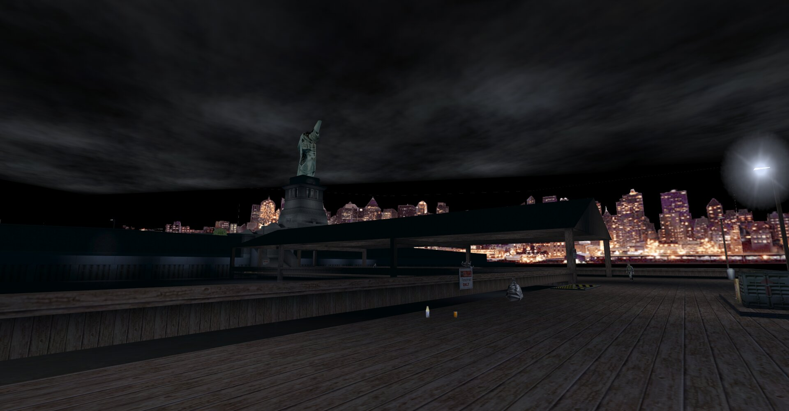
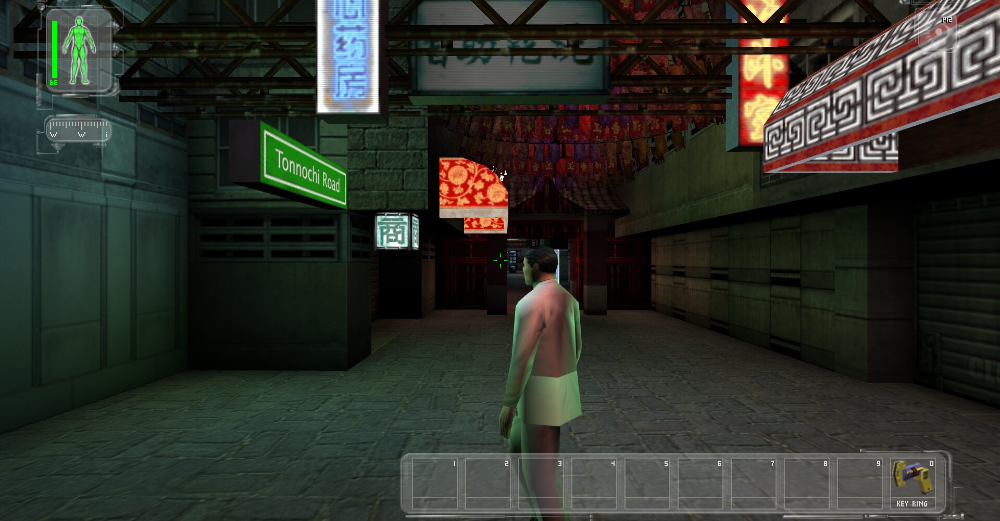
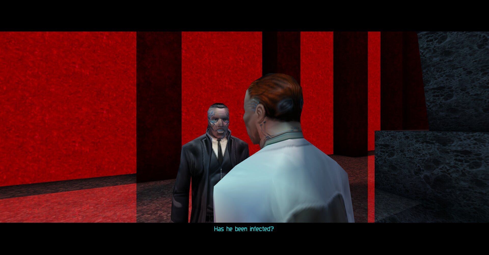
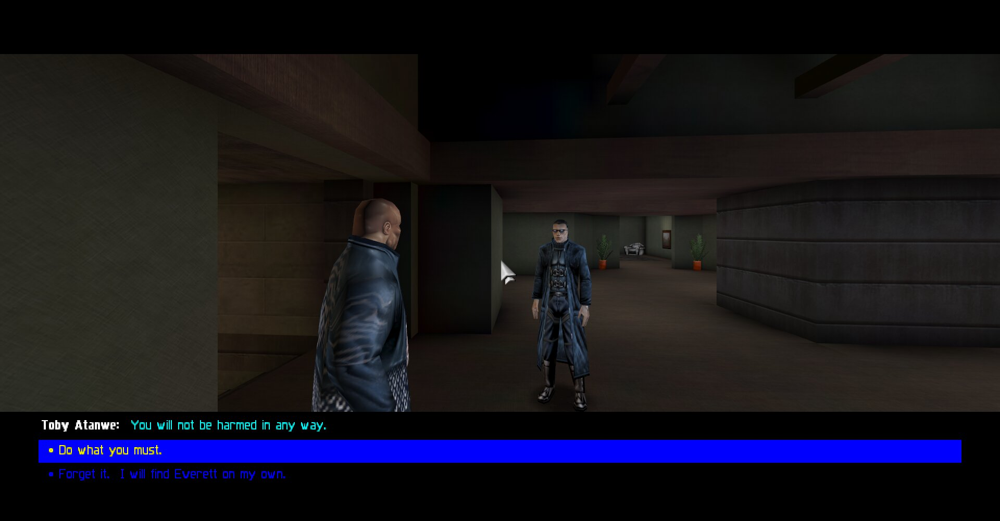
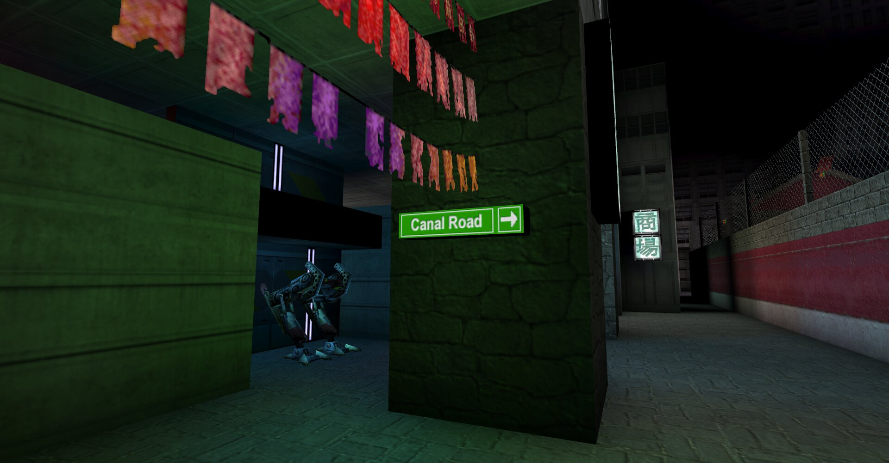
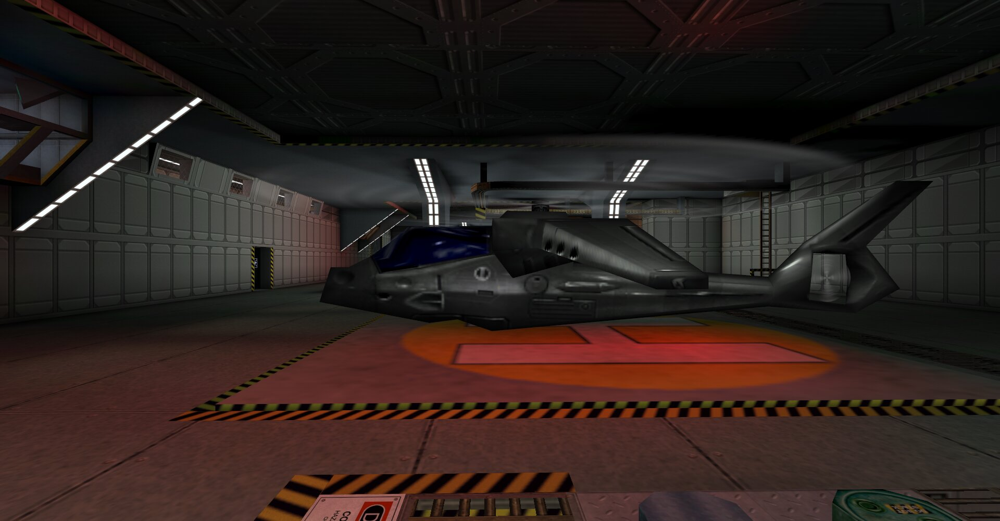
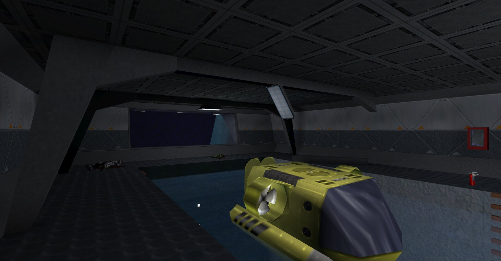

# DXEngine

Deus Ex's engine for modern systems: a hard fork of
[Surreal Engine](https://github.com/dpjudas/SurrealEngine), the open-source reimplementation of
Unreal Engine 1, made to play Deus Ex as the original does, on Linux and Windows, from the
desktop to a handheld.

<p align="center">
  
</p>

**You need your own copy of Deus Ex, version 1112fm.** None of the game's files are included.

## Features

- **Deus Ex as the original plays it.** The game's own scripts run on the engine: its
  conversations and cinematics, its characters' AI, saving, loading and travel between maps,
  multiplayer. Each feature is checked against the original by scripted runs of both engines,
  and [`docs/NATIVES.md`](docs/NATIVES.md) says what differs.
- **Modern renderers.** Vulkan by default, OpenGL, and OpenGL ES 3.2 for handhelds, with
  multisampling and a render scale for slower GPUs; on the CPU alone, on every core, where the GPU
  has no driver.
- **Gamepads.** Through SDL3 or SDL2, mapped to the game's own joystick bindings in `User.ini`,
  its menus included.
- **Linux and Windows.** Linux on x86_64 and aarch64, glibc 2.28 or newer, so any current
  distribution; Windows 10 (1903) or newer on x86_64.
- **From the desktop to the handheld.** The game plays on a PC and on the TrimUI Smart Pro, an
  aarch64 handheld with a PowerVR GPU.
- **Made for a launcher.**
  [DXLauncher](https://github.com/JuggyMcNutty/deusex-launcher/blob/linux-x86_64/README.md)
  keeps the player's settings and saves in profiles and starts the engine; the engine runs on
  its own too, or as a dedicated server.

## Screenshots

<table>
  <tr>
    <td width="50%"></td>
    <td width="50%"></td>
  </tr>
  <tr>
    <td align="center">Hong Kong's Tonnochi Road, the HUD on</td>
    <td align="center">The intro's cinematic</td>
  </tr>
  <tr>
    <td width="50%"></td>
    <td width="50%"></td>
  </tr>
  <tr>
    <td align="center">A conversation and its choices</td>
    <td align="center">Hong Kong's market</td>
  </tr>
  <tr>
    <td width="50%"></td>
    <td width="50%"></td>
  </tr>
  <tr>
    <td align="center">The MJ12 helibase</td>
    <td align="center">The Ocean Lab's submarine bay</td>
  </tr>
</table>

Each is the engine's own shot of the game, on Vulkan with 4× multisampling.

## Download

To play, take your platform's app from
[Port Ex Machina's releases](https://github.com/JuggyMcNutty/port-ex-machina/releases):
DXLauncher and the engine together. This repository's
[releases](https://github.com/JuggyMcNutty/DXEngine/releases) have the engine alone, for each
platform. GitHub's CI builds both, on a pull request here and when Port Ex Machina's pins take a
commit ([CI](https://github.com/JuggyMcNutty/port-ex-machina/blob/main/docs/DEVELOPMENT.md#ci)).

## Building and running

Linux builds are made and tested on Linux, and Windows' cross-built by llvm-mingw and tested
under Proton's wine.

### The easy way: Port Ex Machina

[Port Ex Machina](https://github.com/JuggyMcNutty/port-ex-machina) fetches the engine, builds it
with the launcher for each of its ports, and stages, runs or deploys the result: follow
[its quick start](https://github.com/JuggyMcNutty/port-ex-machina/blob/main/README.md#quick-start).

### Building it on its own

You need:

- a C++20 compiler (GCC 10 or later), CMake 3.15 or later and pkg-config;
- the development files of OpenAL, SDL3 or SDL2, and X11 (with Xi and Xext);
- optionally Wayland's (waylandpp, xkbcommon), EGL, dbus, GLib and fontconfig, used when found.

On Arch these are among the packages
[Port Ex Machina's dependencies](https://github.com/JuggyMcNutty/port-ex-machina/blob/main/docs/DEVELOPMENT.md#dependencies)
list. Then:

```sh
git clone https://github.com/JuggyMcNutty/DXEngine.git
cd DXEngine
cmake -S . -B build -DCMAKE_BUILD_TYPE=Release
cmake --build build --target DXEngine -j"$(nproc)"
```

Its SDL window is SDL3's when SDL3 is found, else SDL2's: either has the engine's gamepad
support, which its X11 and Wayland windows lack, and is the window when `DXE_DISPLAY_BACKEND`
names it ([the gamepad](docs/ENGINE.md#running-on-our-devices)). The build leaves two files
in `build/` that go together:

- `DXEngine`, the engine;
- `DXEngine.pk3`, its resources (the UI's fonts among them), found beside the executable.

### Running it

Give it the game's folder, or start it from the game's `System` folder:

```sh
build/DXEngine /path/to/deusex
```

It draws with Vulkan unless its settings name another device or the game's ini names `SoftDrv`,
and on the CPU, with its software device, where no GPU device starts
([which device draws](docs/ENGINE.md#rendering)). Where to go next:

- [Running it](docs/ENGINE.md#running-it): the rest of the command line -- the log on
  stderr, a map to start on, a dedicated server, the inis.
- [Settings and environment](docs/ENGINE.md#settings-and-environment): the settings file
  and the variables the engine reads, the window backend a pad needs among them.

### For advanced users

The build's own switches:

| Switch | Default | What it does |
|---|---|---|
| `ENABLE_SDL2` | `ON`; on Windows `OFF` | The SDL2 window backend, built when SDL3's is not. |
| `ENABLE_SDL3` | `ON`; on Windows `OFF` | The SDL3 backend: when SDL3 is found, it is built in place of SDL2's. |
| `ENABLE_X11`, `ENABLE_WAYLAND` | `ON` | The desktop's window backends; off for a device with neither. |
| `DXE_SDL2_BORDERLESS_FULLSCREEN` | `OFF` | SDL2's fullscreen as a borderless window, for a vendor SDL2 that deadlocks in `SDL_SetWindowFullscreen`. |
| `ZIPDIR_EXECUTABLE` | unset | A host-built `zipdir` to pack `DXEngine.pk3` with when cross-compiling. |

- **A port's build** is an initial cache (`cmake -C`), `ports/<id>/engine.cmake` on the port's
  launcher branch: the desktop's toolchain and switches
  ([linux-x86_64's](https://github.com/JuggyMcNutty/deusex-launcher/blob/linux-x86_64/ports/linux-x86_64/engine.cmake)),
  or a cross build's
  ([trimui-smartpro's](https://github.com/JuggyMcNutty/deusex-launcher/blob/trimui-smartpro/ports/trimui-smartpro/engine.cmake)).
  Port Ex Machina's `scripts/engine.sh build <port>` builds with it
  ([a port's files](https://github.com/JuggyMcNutty/port-ex-machina/blob/main/docs/PORTING.md#what-a-port-is)).
- **Debugging**: a build with symbols, or with AddressSanitizer
  ([crashes](docs/DEVELOPMENT.md#crashes)).
- **Profiling and validation**: [measuring it](docs/ENGINE.md#measuring-it).
- **Kept, but neither built nor tested here**: MSVC's own, the natvis and the crash reporter's
  Windows part ([Windows](docs/ENGINE.md#running-on-our-devices)).
- **The D3D11 device** is built for Windows alone, drawing in its SDL3 or Win32 window, and
  offered by no launcher.
- **The software device** (`Settings.json`'s `"Type": "Software"`) is built on every platform,
  drawing on the CPU into its window's bitmap on every core: DXLauncher's Software renderer, and
  the device that draws where no GPU device starts
  ([the software device](docs/ENGINE.md#rendering)).

## Status

The engine runs the game, which is not fully playable: [`docs/NATIVES.md`](docs/NATIVES.md)
lists where it differs from the original. Where each platform stands:
[the ports](https://github.com/JuggyMcNutty/port-ex-machina/blob/main/README.md#engine-ports).

## Documentation

| Doc | Read it for |
|---|---|
| [`docs/ENGINE.md`](docs/ENGINE.md) | how the engine is kept, run and profiled, and [what it changes from Surreal Engine](docs/ENGINE.md#what-it-changes-from-surreal-engine) |
| [`docs/NATIVES.md`](docs/NATIVES.md) | where it differs from the original, feature by feature |
| [`docs/DEVELOPMENT.md`](docs/DEVELOPMENT.md) | working on it: scripted runs of both engines, debugging a crash, proving a change |

## DXEngine and Surreal Engine

DXEngine began as Surreal Engine, by Magnus Norddahl, Lupert Everett and its contributors. It
is a hard fork: not in Surreal Engine's fork network, nothing merged from it or sent to it, the
two different at the core ([how it is kept](docs/ENGINE.md#how-it-is-kept)). It plays Deus Ex
alone; other Unreal Engine 1 games do not start.

## License

zlib, as Surreal Engine is: DXEngine's licence, Surreal Engine's and those of the third-party
code it carries are in [`LICENSE.md`](LICENSE.md). Deus Ex belongs to its owners; this project is
not affiliated with or endorsed by them.
